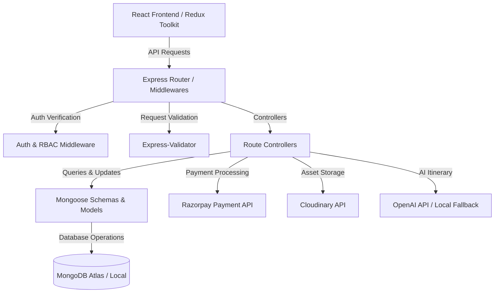

# Project Documentation & Interview Prep Guide: My-Odyssey Travel Platform

Welcome to the comprehensive technical documentation and interview preparation guide for the **My-Odyssey Travel Platform**. This project is a premium, state-of-the-art MERN (MongoDB, Express, React, Node.js) stack web application designed to provide users with travel destination browsing, booking, payment, personalized recommendations, and AI-generated travel itineraries.

---

## 1. System Architecture Overview

The project follows a standard MERN decoupled client-server architecture:



### Key Technical Stack:
- **Frontend**: React (Vite, React Router v6, Redux Toolkit for state management, CSS for modern styling, `react-hot-toast` for notifications).
- **Backend**: Node.js, Express (ES modules, CORS, Helmet for HTTP security headers, Morgan for dev logging, Cookie Parser).
- **Database**: MongoDB (Mongoose ODM, using compound unique indexes, mongoose validation, and aggregation pipelines).
- **External Integrations**: Razorpay (Payments), Cloudinary (Image Upload), OpenAI (AI-Powered Custom Itinerary Generator).

---

## 2. Core Functionalities: What, Why, and Where

This section breaks down the main system functionalities, why specific design choices were made, and where they exist in the codebase.

---

### A. Authentication & Role-Based Access Control (RBAC)

#### What:
A secure jwt-based signup, login, password updates, profile management, and session persistency flow. Features access levels for `user` and `admin` roles.

#### Why:
- **JWT (JSON Web Tokens)**: Decoupled stateless authentication allows scaling without maintaining server-side session stores.
- **Double Token Extraction**: Supports token verification from both `Authorization: Bearer <token>` headers (useful for mobile clients or programmatic access) and `HTTP-only cookies` (to protect browser-based clients from Cross-Site Scripting (XSS) attacks).
- **Bcrypt Password Hashing**: Ensures user passwords are encrypted with a random salt before database insertion, protecting user identity even if the database is compromised.

#### Where:
- **Database Schema**: [User.js](file:///f:/rr/server/models/User.js) (Defines fields, schema methods for password comparison and hashing on saving).
- **Authentication Routes**: [authRoutes.js](file:///f:/rr/server/routes/authRoutes.js).
- **Authentication Middleware**: [auth.js](file:///f:/rr/server/middleware/auth.js) (Implements `protect` and `authorize` role check functions).
- **Authentication Controller**: [authController.js](file:///f:/rr/server/controllers/authController.js) (Handles register, login, logout, and profile/password updates).
- **Frontend State Slice**: [authSlice.js](file:///f:/rr/client/src/redux/slices/authSlice.js).

---

### B. Destination Catalog Search, Filtering & Pagination

#### What:
A high-performance search and filter endpoint that allows exploration of travel packages by keyword, categories, ratings, sorting criteria, price ranges, and page offsets.

#### Why:
- **Reusability (`APIFeatures` helper)**: Instead of writing complex query parse logic in every controller, an `APIFeatures` class wraps Mongoose queries to enable chaining of `.search()`, `.filter()`, `.sort()`, `.limitFields()`, and `.paginate()` dynamically.
- **Database Indexes**: Compound index mapping like indexing `slug` and `isActive` optimizes high-frequency query performance.

#### Where:
- **Database Schema**: [Destination.js](file:///f:/rr/server/models/Destination.js).
- **Helper Utility**: [apiFeatures.js](file:///f:/rr/server/utils/apiFeatures.js).
- **Destination Routes**: [destinationRoutes.js](file:///f:/rr/server/routes/destinationRoutes.js).
- **Destination Controller**: [destinationController.js](file:///f:/rr/server/controllers/destinationController.js) (Uses the `APIFeatures` helper in `getDestinations`).
- **Frontend Explore Page**: [ExplorePage.jsx](file:///f:/rr/client/src/pages/ExplorePage.jsx).

---

### C. Booking Engine & Pricing Calculation

#### What:
Enables registered users to book vacation packages. It dynamically calculates the final price, tracks the current status (`pending`, `confirmed`, `cancelled`), and manages payment states (`unpaid`, `paid`).

#### Why:
- **Dynamic Server-Side Calculations**: Client-provided price parameters should **never** be trusted directly due to potential request tampering. Price is calculated server-side based on travelers count, duration, and database records of base price.
- **Relational Integrity**: Uses `populate()` to link destinations and user metadata to booking records without duplicating the fields in the DB.

#### Where:
- **Database Schema**: [Booking.js](file:///f:/rr/server/models/Booking.js).
- **Booking Routes**: [bookingRoutes.js](file:///f:/rr/server/routes/bookingRoutes.js).
- **Booking Controller**: [bookingController.js](file:///f:/rr/server/controllers/bookingController.js) (Contains `calculatePrice` helper, booking creation, retrieval, and cancel functions).
- **Frontend Booking Form**: [BookingPage.jsx](file:///f:/rr/client/src/pages/BookingPage.jsx).

---

### D. AI-Powered Itinerary Generator

#### What:
Generates custom day-by-day travel itineraries. If an OpenAI API Key is configured, it contacts GPT-4o-mini to return a custom response formatted as JSON. If no API key exists, it falls back to a rule-based generator that picks activities matching the package category (e.g. beach activities vs mountain trekking).

#### Why:
- **Graceful Degradation**: Using a hybrid fallback ensures the system is resilient and always works locally or in environments where OpenAI is disabled, without throwing unhandled server failures.
- **JSON Mode**: Recommending `response_format: { type: 'json_object' }` on GPT models ensures the API returns reliable structured data that can be programmatically rendered in the frontend.

#### Where:
- **Service Logic**: [itineraryService.js](file:///f:/rr/server/services/itineraryService.js).
- **Route Trigger**: [destinationRoutes.js](file:///f:/rr/server/routes/destinationRoutes.js) (Uses `POST /api/destinations/:id/itinerary`).
- **Destination Controller**: [destinationController.js](file:///f:/rr/server/controllers/destinationController.js) (Handler `generateAIItinerary`).

---

### E. Personalized Recommendations

#### What:
Returns tailored destination cards for users based on their stored category preferences, budget limits, and history of recently viewed destinations.

#### Why:
- **Contextual Relevancy**: Analyzing user history ($slice restricted to 10 entries) and preferences increases engagement by highlighting packages that match actual user interests.
- **Optimized MongoDB Operators**: Uses `$in`, `$lte`, and `$or` to find matching documents efficiently on the database level.

#### Where:
- **Service Logic**: [recommendationService.js](file:///f:/rr/server/services/recommendationService.js).
- **Destination Controller**: [destinationController.js](file:///f:/rr/server/controllers/destinationController.js) (Handler `getRecommendations`).
- **Database User Schema**: [User.js](file:///f:/rr/server/models/User.js) (Houses `preferences` object and `recentlyViewed` array schema definition).

---

### F. Razorpay Payment Gateway Integration

#### What:
Enables secure real-money checkout using the Razorpay gateway. Flow works in 2 stages:
1. **Order Creation**: Server generates a unique order reference through the Razorpay SDK and logs a transaction in the database.
2. **Payment Verification**: Razorpay client payment generates signatures. The server verifies this signature using a SHA-256 HMAC hash block before capturing the transaction and marking the booking status as confirmed.

#### Why:
- **HMAC Verification Security**: Verification prevents malicious users from spoofing successful payments via fake client payloads. Signature validation ensures that the payment was processed and finalized by Razorpay.
- **Atomicity**: Updates booking state to confirmed, creates a verified payment tracking document, and issues a user notification inside the same operation chain.

#### Where:
- **Database Schema**: [Payment.js](file:///f:/rr/server/models/Payment.js).
- **Razorpay Config**: [razorpay.js](file:///f:/rr/server/config/razorpay.js).
- **Payment Routes**: [paymentRoutes.js](file:///f:/rr/server/routes/paymentRoutes.js).
- **Payment Controller**: [paymentController.js](file:///f:/rr/server/controllers/paymentController.js) (Handlers `createOrder` and `verifyPayment`).

---

### G. Admin Dashboard & Analytics Pipeline

#### What:
Provides dashboard aggregates showing total users, destinations, active bookings, overall revenue, monthly earnings chart, and list of pending actions.

#### Why:
- **High-Performance Aggegration**: Rather than fetching thousands of rows to calculate statistics inside Node.js memory (which blocks the event loop), it utilizes **MongoDB Aggregation Pipelines**. Computations (grouping, filtering, sorting, summing) are run in the DB engine, only returning the computed result.

#### Where:
- **Admin Routes**: [adminRoutes.js](file:///f:/rr/server/routes/adminRoutes.js).
- **Admin Controller**: [adminController.js](file:///f:/rr/server/controllers/adminController.js) (Handler `getDashboardStats` uses aggregate queries `$group`, `$sum`, `$year`, `$month`, and `$match` for monthly data).
- **Frontend Dashboard**: [AdminDashboard.jsx](file:///f:/rr/client/src/pages/admin/AdminDashboard.jsx).

---

### H. Smart Travel Assistant Chatbot

#### What:
A premium floating chatbot assistant named **OdysseyBot** integrated globally in the browsing pages. It answers travel questions, suggests destinations, calculates budget estimates, and helps users understand how to book packages.

#### Why:
- **Enhanced Conversion**: An interactive floating chat widget helps resolve user questions instantly, keeping them on the site and driving them toward booking.
- **Hybrid API Architecture**: It uses a fallback design. If an OpenAI API key is set, it contacts the GPT-4o-mini API with full catalog context. If the key is not set, it performs offline token/keyword parsing and queries the database for destinations, ensuring it is highly reactive and functional even offline.
- **Micro-Animations & Suggestion Chips**: Clicking quick suggestions instantly fires the request, reducing typing friction.

#### Where:
- **Backend Routes**: [chatbotRoutes.js](file:///f:/rr/server/routes/chatbotRoutes.js).
- **Backend Controller**: [chatbotController.js](file:///f:/rr/server/controllers/chatbotController.js).
- **Frontend UI Component**: [Chatbot.jsx](file:///f:/rr/client/src/components/common/Chatbot.jsx).
- **Frontend Layout Wrapper**: [MainLayout.jsx](file:///f:/rr/client/src/layouts/MainLayout.jsx).

---

## 3. Core Database Design & Schema Architecture

Below is the database relationship schema demonstrating how the models connect.

```
+-------------+
|    User     | <-------------------------+
+-------------+                           |
       | 1                                |
       |                                  |
       | 1-to-Many                        |
       v                                  |
+-------------+             +-------------+
|   Booking   | ----------> |   Payment   |
+-------------+ 1-to-1      +-------------+
       | 1                         | 1
       |                           |
       | 1-to-Many                 |
       v                           |
+-------------+                    |
| Destination | <------------------+
+-------------+
       | 1
       |
       | 1-to-Many
       v
+-------------+
|   Review    |
+-------------+
```

### Unique Schema Indexes:
- **User Email**: `unique: true` to prevent double registrations.
- **Review (Destination, User)**: `reviewSchema.index({ destination: 1, user: 1 }, { unique: true })` ensures a user can leave only **one** review per destination, preventing rating manipulation.

---

## 4. Key Security Implementations

Security is standard in the Express application:
1. **Helmet Middleware**: Configures HTTP headers automatically to guard against Clickjacking, Cross-Site Scripting (XSS), and sniff attacks.
2. **CORS Configuration**: Restricts API calls to approved origins (`CLIENT_URL` or `http://localhost:5173`) and allows credentials (sending authentication cookies).
3. **HTTP-only Cookies**: Ensures the auth token cannot be read from frontend JavaScript execution via `document.cookie` commands, protecting against session hijacking via XSS vulnerabilities.
4. **Rate Limiting**: Enforces max 200 API requests per 15 minutes per IP (`express-rate-limit`) to prevent brute-force attacks and Denial of Service (DoS).
5. **Input Validation**: Uses `express-validator` to sanitize and check email shapes, password lengths, and required inputs before processing controllers.

---

## 5. MERN Stack Interview Q&A Guide

Below are the key interview questions and answers tailored to this codebase. Use these to showcase your understanding of the architecture, database constraints, and external integrations.

---

### Q1: What was the recent backend crash in the project and how did you resolve it?
**Answer**:
The project suffered from two distinct backend issues:
1. **Startup Failure (EADDRINUSE)**: The server failed to start because port `5000` (and `5173` for the client) was occupied by orphaned background Node/Vite processes left over from previous runs. I tracked the process PIDs using `netstat -ano | findstr :5000` and terminated them using the `taskkill /F /PID` command.
2. **Database Seeding Crash (Duplicate Review Constraint)**: When running `npm run seed`, the script crashed with a MongoDB unique key violation (`E11000 duplicate key error`). The database schema enforces that a user can only review a destination once using a compound unique index: `reviewSchema.index({ destination: 1, user: 1 }, { unique: true })`. However, the seed script looped through a single traveler user and tried to insert three reviews for the same destination. I resolved this by modifying `seedData.js` to create three distinct seed users (`John Traveler`, `Jane Explorer`, and `Bob Nomad`) with corresponding wishlists, and distributed the reviews among them, satisfying the database constraint.

---

### Q2: Why is signature verification critical during Razorpay payment integration, and how is it implemented?
**Answer**:
Signature verification prevents **payment spoofing**. Without it, a user could capture the order ID from the client, bypass payment, construct a fake HTTP POST payload containing `success`, and send it to our verification endpoint to confirm their booking without paying.

We verify payments by checking a secure signature generated by Razorpay.
- In `paymentController.js`, we retrieve `razorpay_order_id` and `razorpay_payment_id` from the request body.
- We concatenate them with a pipe character: `${razorpay_order_id}|${razorpay_payment_id}`.
- We compute a SHA-256 HMAC signature of this string using our secret API key (`process.env.RAZORPAY_KEY_SECRET`).
- If this server-computed signature matches the `razorpay_signature` sent by the client, we know the transaction is genuine and update the booking to `confirmed`.

---

### Q3: Explain how the search, filtering, and pagination logic works in this project.
**Answer**:
It is implemented via an `APIFeatures` class in [apiFeatures.js](file:///f:/rr/server/utils/apiFeatures.js) which abstracts MongoDB querying:
- **Search**: Checks if there is a `keyword` query parameter. If so, it creates a regex-based search criteria on `title`, `location`, or `country`.
- **Filtering**: Strips out utility fields (like `keyword`, `sort`, `page`, `limit`, `fields`) from the query object, converts operators (like `gt`, `gte`, `lt`, `lte`) into Mongo syntax (appending `$` prefix), and filters the matching models.
- **Sorting**: Parses the `sort` query parameter and applies it to the Mongoose query. Default sorting is descending by creation time (`-createdAt`).
- **Field Limiting**: Selects specific fields to return, reducing network payload size.
- **Pagination**: Calculates standard offsets using `skip = (page - 1) * limit` to retrieve only the requested block of data.

---

### Q4: How is state managed on the frontend in this application, and why was this approach chosen?
**Answer**:
The frontend uses **Redux Toolkit** to manage global state (e.g. authentication status, wishlist items, travel details).
- **Why**: Redux Toolkit provides a single source of truth for features that span across multiple disconnected components. For example, if a user toggles a package on their wishlist, both the header nav counter, the wishlist page, and the card's wishlist icon update immediately.
- It uses `createAsyncThunk` to handle asynchronous API transactions (e.g. login, fetching trips). The actions automatically dispatch pending, fulfilled, and rejected states, allowing loading spinners and error alerts to bind dynamically.
- Component-specific settings (like toggling light/dark layout modes) are managed via a lighter React Context API (`ThemeContext.jsx`).

---

### Q5: How do you handle error management in the Express backend, and how does it prevent security leaks?
**Answer**:
We use an asynchronous express routing handler wrapper combined with a centralized Express error handling middleware:
- **Express Async Handler**: Wrap all controller callbacks in `express-async-handler`. This catches any rejected Promises (errors thrown inside async functions) and routes them automatically to `next(err)`.
- **Centralized Middleware**: The error handler middleware in [errorHandler.js](file:///f:/rr/server/middleware/errorHandler.js) captures these errors and translates typical database errors (e.g., CastError, validation issues, JWT expiration, duplicate key errors) into structured, readable HTTP error status codes.
- **Security Leak Prevention**: It prints the error stack trace (`err.stack`) in the HTTP response **only** when `process.env.NODE_ENV === 'development'`. In production, this stack trace is hidden to prevent exposing server file paths or database details to external attackers.

---

### Q6: Why did you use MongoDB Aggregation Pipelines in the admin controller?
**Answer**:
In `adminController.js`, we need to compute complex statistics such as monthly revenue and booking status counts.
- **The wrong way**: Fetching all bookings and payments into Node.js application memory and using JavaScript loop filters. If the database has 100,000 records, this blocks the single-threaded Node event loop, consumes huge server memory, and degrades performance.
- **The aggregation way**: Aggregation pipelines (`Payment.aggregate([...])`) run inside the database system itself. Using operators like `$match` (to select only successful payments), `$group` (to group transactions by year/month), and `$sum` (to calculate totals), MongoDB computes the result and returns a small, finalized object of numbers. This is fast, resource-efficient, and scalable.

---

### Q7: What are the security vulnerabilities guarded by using HTTP-Only cookies for JWT?
**Answer**:
If a JWT is stored in HTML5 LocalStorage, any script running on the client can read it via `localStorage.getItem('token')`. This exposes the application to **Cross-Site Scripting (XSS)**. If a malicious third-party script gets injected into the page, it can steal the token and hijack the user session.

By setting the JWT in a cookie with the `httpOnly: true` flag:
- The browser automatically attaches this cookie to every outgoing API request.
- Client-side JavaScript cannot read or write to this cookie.
- This mitigates session theft via XSS because even if a script is compromised, it cannot access the authentication token.

---

### Q8: What does the unique index `{ destination: 1, user: 1 }` on the Review model accomplish, and how is it defined?
**Answer**:
It enforces **rating integrity**. It ensures that a single user can write at most one review for any given travel destination. If they try to write another, the database rejects the write with a duplicate key error.

It is defined in the Mongoose schema [Review.js](file:///f:/rr/server/models/Review.js) using:
`reviewSchema.index({ destination: 1, user: 1 }, { unique: true });`

When the database starts, Mongoose registers this unique compound index in MongoDB.

---

### Q9: How does the AI Itinerary Generator handle API keys, and what is its fallback behavior?
**Answer**:
The itinerary generator is located in [itineraryService.js](file:///f:/rr/server/services/itineraryService.js):
- **OpenAI Path**: If `process.env.OPENAI_API_KEY` is configured, it sends a POST request to the OpenAI chat completions endpoint using `gpt-4o-mini` with a system instruction to return a JSON array containing itinerary days, titles, descriptions, and activities.
- **Fallback Path**: If the API key is empty or the network request fails, it catches the error and falls back to a rule-based generator. This generator retrieves static activities organized by category (e.g. hiking for mountains, sunbathing for beaches) and populates a day-by-day structure matching the destination's duration. This ensures the user experience never breaks.

---

### Q10: How does the backend handle user photo uploads, and how is it integrated with the cloud?
**Answer**:
1. **Multipart Data Handling**: The server uses **Multer** middleware (`upload.js`) to parse multipart/form-data requests.
2. **Buffer Uploads**: Rather than saving images onto the server's local file system (which makes the server stateful and hard to scale), Multer holds the image file in temporary memory buffers (`file.buffer`).
3. **Cloudinary Upload**: The buffer is sent directly to the **Cloudinary SDK** via a secure helper function `uploadToCloudinary` in `cloudinaryService.js`. Cloudinary stores the image, and returns a secure CDN URL and public asset ID which we then save in the destination's Mongoose document.

---

### Q11: Explain the purpose of `express-async-handler`.
**Answer**:
In Express, any unhandled error inside a route handler (such as a database query timeout or a rejected Promise) must be manually caught using `try-catch` blocks and passed to `next(err)` to trigger the error handling middleware.

If a developer forgets a `try-catch` block around an asynchronous database operation, the rejected Promise causes an `UnhandledPromiseRejection`, which can crash the entire Node process.

`express-async-handler` is a utility wrapper that automatically catches any errors or rejected Promises inside the wrapped controller function and forwards them to the Express error middleware, eliminating the need to write repetitive `try-catch` boilerplate code.

---

### Q12: How are personalized recommendations constructed in `recommendationService.js`?
**Answer**:
1. **Query Initialization**: We start with an query object requesting active destinations: `{ isActive: true }`.
2. **User Preferences**: If the authenticated user has pre-selected category preferences (e.g., `['beach', 'cultural']`), we filter destinations using the `$in` operator: `query.category = { $in: user.preferences.categories }`.
3. **Budget Bounds**: If a maximum budget is set, we append a less-than-or-equal filter: `query.pricePerPerson = { $lte: user.preferences.budgetRange.max }`.
4. **History Boost**: We extract the IDs of recently viewed destinations. We query their categories and countries, and expand our search query using `$or` to find other active packages with matching categories or countries.
5. **Sorting & Limits**: The result is sorted by ratings descending, and limited to return the top 6 matches without the massive itinerary texts to keep payload lightweight.

---

### Q13: What does Helmet middleware do, and why did you configure `crossOriginResourcePolicy`?
**Answer**:
Helmet helps secure Express apps by setting various HTTP headers.
We configured it in `server.js` as:
`app.use(helmet({ crossOriginResourcePolicy: { policy: 'cross-origin' } }));`

**Why**: By default, Helmet enables a strict Cross-Origin Resource Policy (CORP) which blocks browsers from loading assets (like destination photos) hosted on our server when requested by a different domain (the client running on `http://localhost:5173`). Setting the policy to `cross-origin` allows the frontend client to successfully download and render images served directly by the backend API.

---

### Q14: How does the application calculate the booking price dynamically?
**Answer**:
In [bookingController.js](file:///f:/rr/server/controllers/bookingController.js):
- It calculates the number of travel days using the difference between `endDate` and `startDate` converted from milliseconds: `Math.ceil((endDate - startDate) / (1000 * 60 * 60 * 24))`.
- The base price is: `pricePerPerson * travelers`.
- A duration multiplier is computed: `days / destination.duration`.
- The final price is: `Math.round(base * Math.max(durationMultiplier, 0.5))`.
This ensures booking prices scale dynamically and realistically with the length of the trip, with a minimum cost safeguard (0.5 multiplier).

---

### Q15: How does the application support responsive dark/light mode toggling?
**Answer**:
- **Context API**: React Context (`ThemeContext.jsx`) maintains the current global theme state (`light` or `dark`) and persists the selection to `localStorage`.
- **CSS Variable Injection**: When the theme changes, a `dark` class is toggled on the root document element.
- **Styling**: Modern, premium CSS styling uses variables or Tailwind utilities mapped to the root theme selector to change background colors, text colors, and shadows, providing a smooth, responsive dark mode transitions.

---

### Q16: How is the Chatbot designed, and how does the hybrid offline-online response model function?
**Answer**:
- **Frontend Interface**: Designed as a floating glassmorphic widget (`Chatbot.jsx`) rendered globally within the layout. It maintains a message list state, auto-scrolls using a `useRef` scroll-anchor, and displays quick action suggestion chips.
- **Backend Architecture**: The `/api/chatbot` route decodes the user's JWT from headers or cookies to greet them by name.
- **Hybrid Execution Model**:
  1. **Online Mode (OpenAI)**: If `OPENAI_API_KEY` is present, it fetches a list of active destinations and highlights from the database, feeds this text catalog dynamically to `gpt-4o-mini` as context, and queries the model.
  2. **Offline Fallback (MongoDB)**: If the API key is not set, it executes a local rule-based router. It parses the message for keywords (e.g. "bali", "beach", "cheap", "book", "recommend"). If a match is found, it queries MongoDB (e.g., retrieving the cheapest packages or destinations in a category) and formats the results as clean markdown responses. This ensures the chatbot remains fully functional locally.

